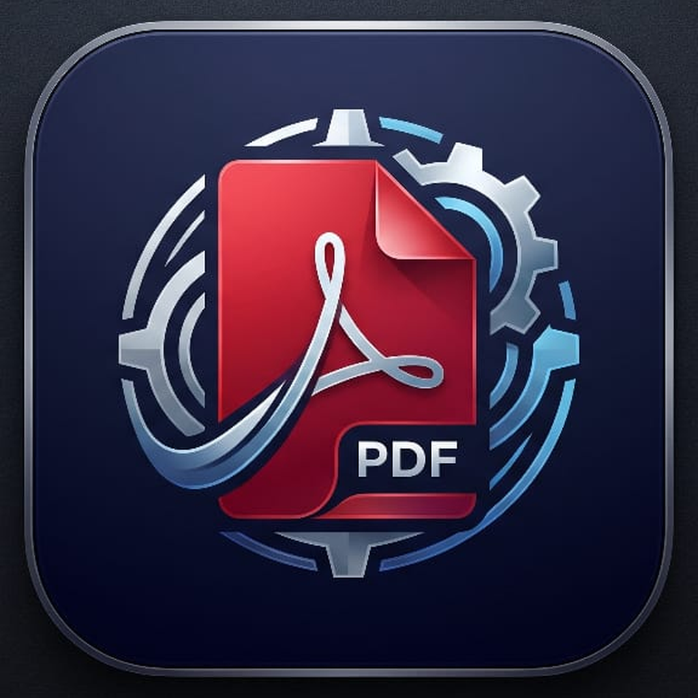
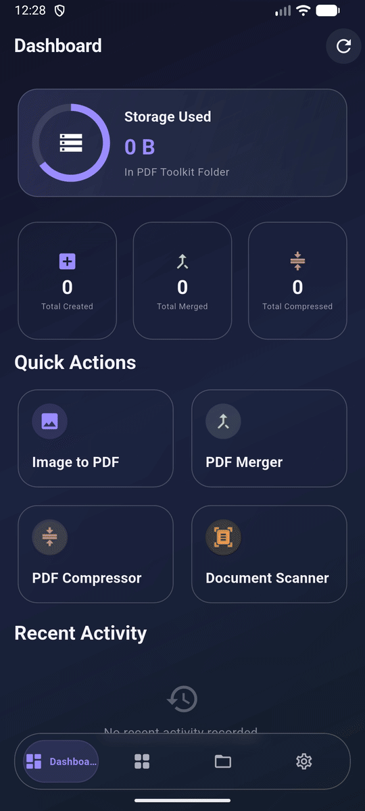
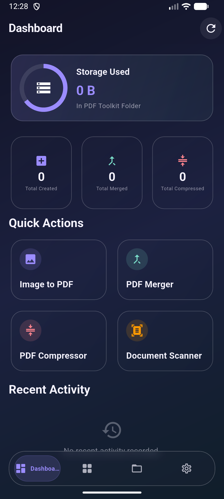
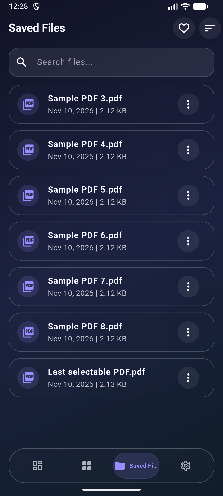
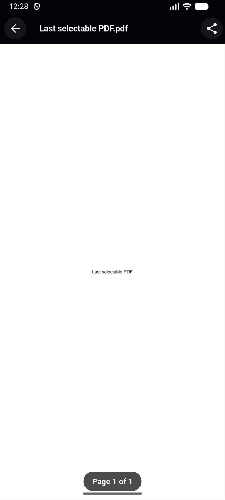

<p align="center">
  
</p>

<h1 align="center">PDF Toolkit</h1>

<p align="center">
  A clean, on-device workspace for the PDF tasks you do every day.
</p>

<p align="center">
  <a href="https://github.com/shivubuilds-mikasa/pdf-toolkit/releases/latest">
    
  </a>
  
  
  
</p>

<p align="center">
  <a href="https://github.com/shivubuilds-mikasa/pdf-toolkit/releases/latest/download/app-release.apk"><strong>⬇ Download the latest APK</strong></a>
  &nbsp; · &nbsp;
  <a href="https://github.com/shivubuilds-mikasa/pdf-toolkit/releases">All releases</a>
</p>

<p align="center">
  
</p>

## Your PDFs, one place

Convert, organize, and work with PDFs from a single app. The interface keeps your tools close, your recent work easy to find, and your saved documents accessible all the way to the bottom of the list.

## ✨ What you can do

| Tool | What it does |
| --- | --- |
| 🖼️ **Image to PDF** | Turn one or more images into a PDF. |
| 📷 **Document Scanner** | Capture paper documents with your camera and save them as PDFs. |
| 🔗 **PDF Merger** | Combine multiple PDFs into one file. |
| ✂️ **PDF Splitter** | Extract page ranges or split a document into separate pages. |
| 📦 **PDF Compressor** | Reduce file size with adjustable compression. |
| 🔄 **Page Rotation** | Rotate selected pages or an entire document. |
| 🔐 **Password Protect** | Add or remove PDF passwords. |
| 📁 **Saved Files** | Search, sort, favorite, rename, share, and open your PDFs. |

## 📱 Screenshots

<table>
  <tr>
    <th align="center">Dashboard</th>
    <th align="center">Saved files</th>
    <th align="center">PDF reader</th>
  </tr>
  <tr>
    <td align="center"></td>
    <td align="center"></td>
    <td align="center"></td>
  </tr>
</table>

The animated tour above cycles through these screens with a soft crossfade.

## 📦 Install

Download **PDF Toolkit v1.0.5** from the latest GitHub release:

<p align="center">
  <a href="https://github.com/shivubuilds-mikasa/pdf-toolkit/releases/latest/download/app-release.apk">
    
  </a>
</p>

Open the downloaded APK on your Android device and follow Android’s install prompt. The release page also contains previous versions and release notes.

## 🧑‍💻 Run from source

### Requirements

- Flutter SDK
- Android Studio or Android SDK
- An Android device or emulator

### Start the app

```bash
git clone https://github.com/shivubuilds-mikasa/pdf-toolkit.git
cd pdf-toolkit
flutter pub get
flutter run
```

### Build a release APK

```bash
flutter build apk --release
```

The APK is written to `build/app/outputs/flutter-apk/app-release.apk`.

## 🧱 Built with

- **Flutter & Dart** for the app and interface
- **Material 3** components with a glass-inspired theme
- **Riverpod** for app state
- Native Android document scanning and local file storage

## 🔒 Your documents

PDF Toolkit is built around local document workflows. Camera access is used by the document scanner; your PDFs remain in the app’s chosen storage location so you can manage them from Saved Files.

## 🤝 Contributing

Bug reports and improvements are welcome. When opening an issue, include your device and Android version, steps to reproduce, and what you expected to happen.

---

<p align="center">
  <strong>PDF Toolkit</strong><br />
  Make PDFs. Keep moving.
</p>
